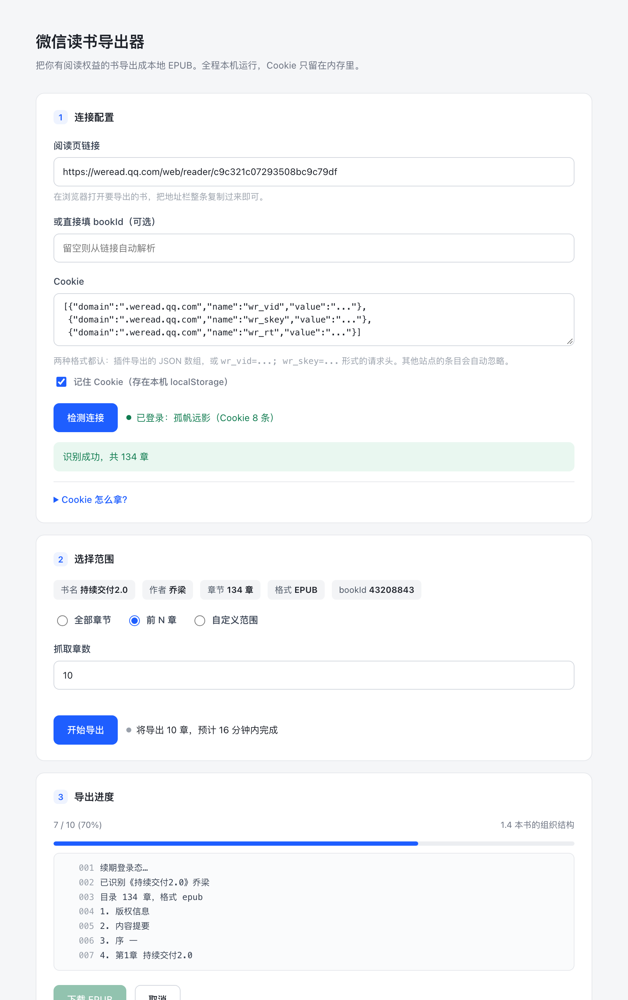

# 微信读书导出器

把**你有阅读权益的**微信读书书籍导出成本地 EPUB。三种用法，按省事程度排序。

> 参考实现：[finlater/weread.koplugin](https://github.com/finlater/weread.koplugin)（KOReader 插件，开源）

## 拿到就能跑

仓库里不含编译产物和导出的书（见 `.gitignore`），clone 后先构建：

```bash
git clone git@github.com:Credochen/weread-export.git
cd weread-export/go
go build -buildvcs=false -o ../weread-export .
cd ..
./weread-export          # 或双击「开始使用.command」
```

要求：Go 1.22+（用到 `ServeMux` 的路径模式）、macOS 或 Linux。跑起来后浏览器打开 <http://127.0.0.1:8791>。

## 三条路怎么选

| 路线 | 形态 | 适合 |
|---|---|---|
| **网页版**（推荐） | 单文件 Go 程序，双击跑起来用浏览器操作 | 不想碰命令行 |
| 命令行脚本 | 上游的 `fetch_weread_epub.py` | 批量、写进脚本、挂定时任务 |
| 自己改 | `go/` 下的 Go 源码，算法已移植并验证 | 想二次加工（转 Markdown、拆章节等） |

插件那 220 个 Lua 文件**不用管**——90% 是 KOReader 的 UI、划线弹窗、进度同步。真正值钱的是上游 `scripts/fetch_weread_epub.py` 和 `docs/weread-api-reference.md`。

---

## 一、网页版：3 步搞定

### 1. 启动

**双击 `开始使用.command`**，或者：

```bash
cd /Users/cgp/Documents/weread-export
./weread-export
```

> 双击 `.command` 会开一个终端窗口跑服务，关掉那个窗口服务就停了。

会自动打开 <http://127.0.0.1:8791>。参数：

| 参数 | 默认 | 说明 |
|---|---|---|
| `-port` | 8791 | 监听端口 |
| `-out` | `out` | EPUB 输出目录 |
| `-no-open` | false | 不自动开浏览器 |

只监听 `127.0.0.1`，外部访问不到。Cookie 只存在进程内存里（勾了「记住 Cookie」才会落 localStorage）。

### 2. 填三项，点「检测连接」

- **阅读页链接**：浏览器打开要导出的书，地址栏整条复制过来
- **Cookie**：两种格式都认

  | 格式 | 长相 | 来源 |
  |---|---|---|
  | 插件导出的 JSON | `[{"domain":".weread.qq.com","name":"wr_vid",...}]` | Cookie-Editor / EditThisCookie |
  | 原始 Cookie 头 | `wr_vid=...; wr_skey=...; wr_rt=...` | F12 → Network → 任一请求 → 请求头 |

  JSON 里往往夹着一堆 `.qq.com` 的统计 Cookie（`pgv_pvid`、`_qimei_*`、`a_sk__*` 等），程序会自动只挑 `weread.qq.com` 的，其余丢弃。

  检测失败时界面会直接告诉你**解析到几条 Cookie**、分别是哪些：条数为 0 是粘贴内容的问题；条数正常还报 `-2010` 才是账号侧的问题。

- 点检测后，界面会回显书名、作者、章节数、格式、bookId，并标出付费章数量



> 上图是把三个步骤都展开的示意（真实使用时，第 2、3 块在检测成功后才出现）。

### 3. 选范围，开始导出

三种模式：**全部章节** / **前 N 章** / **自定义范围**（`1-20,35,60-`）。

导出过程通过 SSE 实时推进度：每章一行日志、进度条、当前章节名。完成后出现「下载 EPUB」按钮，文件同时落在 `out/` 目录。

**先抓 2 章试水**，确认能正常打开、有正文、图没丢，再放开整本。

---

## 二、整体链路

```
① 浏览器登录 → 拿到 Cookie（wr_vid / wr_skey / wr_rt / wr_fp）
        ↓
② POST /web/login/renewal          续期，避免 -2012
        ↓
③ GET  /web/reader/{e(bookId)}     扒 window.__INITIAL_STATE__
        ↓                          取 reader.psvts / pclts / token
④ POST /web/book/chapterInfos      拿目录（chapterUid / title / wordCount / tar）
        ↓
⑤ 逐章：GET 阅读页拿 psvts
        POST /web/book/chapter/e_0 / e_1 / e_3     正文分片（加密）
        POST /web/book/chapter/e_2  (st=1)         样式分片
        GET  chapter.tar                           图片资源
        ↓
⑥ 解码：MD5 校验 → 换位还原 → base64 → UTF-8 重组
        ↓
⑦ 拼装 EPUB3（mimetype / container.xml / content.opf / toc.ncx / nav.xhtml / 各章 xhtml）
```

关键点：**每个请求都要签名**。`s` 是对"排序后的 query 串"做一轮位移异或算出来的，`b`/`c`/`pc` 是 bookId / chapterUid / 时间戳经 `_e()` 编码后的值。少一个字段、`false` 拼成 `False`、`ps` 用过期值，接口都只回一个 `{}`。

---

## 三、命令行脚本

不想开浏览器，或者要批量跑：

```bash
python3 fetch_weread_epub.py \
  --reader-url "https://weread.qq.com/web/reader/<hash>" \
  --cookie-string "wr_vid=...; wr_skey=...; wr_rt=..." \
  --save-cookies ./cookies.txt \
  --limit 2 \
  --output "./out/_probe.epub"
```

| 参数 | 说明 |
|---|---|
| `--reader-url` | 阅读页完整 URL，自动解析 bookId |
| `--book-id` | 已知 bookId 时直给 |
| `--limit N` | 只抓前 N 章 |
| `--skip N` | 跳过前 N 章，断点续抓 |
| `--sleep 0.2` | 分片间隔，默认 200ms |
| `--cookie-file` | 复用已保存的 Cookie |

还有个**体检脚本**，不导书只看链路通不通（只报状态，不打印正文）：

```bash
python3 probe.py \
  --reader-url "https://weread.qq.com/web/reader/<hash>" \
  --cookie-string "wr_vid=...; wr_skey=...; wr_rt=..."
```

退出码 `0` 全通 / `2` 有阻断项 / `1` 致命错误。

---

## 四、Go 源码结构

```
go/
├── weread_core.go        算法层：_e 编码 / 签名 / 分片解码（已交叉验证）
├── client.go             HTTP 客户端、Cookie、阅读页解析、目录、分片、tar 图片
├── epub.go               EPUB3 打包
├── job.go                任务管理、范围选择、SSE 事件
├── main.go               Web 服务 + 内嵌前端
└── web/index.html        界面（单文件，无构建步骤）
```

重新构建：

```bash
cd go
go build -buildvcs=false -o ../weread-export .
go test ./...            # 单元测试
go run . selftest        # 算法自检
```

### 已经验证到什么程度

| 模块 | 验证方式 | 结果 |
|---|---|---|
| `WereadE` / `WereadSign` / `WebAppID` | 官方文档向量 + **真实阅读页哈希复算** | 一致 |
| `SwapPositions` / `DecodePayload` | 40 组随机样本与 Python 实现逐一对齐 | 一致 |
| 分片解码 | 对真实分片跑通 MD5 校验 | 通过 |
| EPUB 打包 | 单元测试校验 mimetype 位置/压缩方式/条目完整性 | 通过 |
| 目录接口 | 无 Cookie 实测返回 `-2010` | 符合预期 |

**没有验证的**：带有效 Cookie 的整本导出（需要你自己的账号）。这也是为什么建议先抓 2 章试水。

### 两个实现坑（真踩过）

1. **Go 的 RE2 不支持反向引用**。上游用 `src=(['"])(.*?)\1` 匹配图片，Go 里直接 panic，得手写扫描配对引号。
2. **`mimetype` 条目不能设 `Modified`**。Go 会顺带写入扩展时间戳 extra 字段，严格的阅读器据此拒收；OCF 要求该条目 extra 为空。
3. `weread_sign` 里 `0x15051505` 超过 int32，用 `int64` 算再 `& 0x7FFFFFFF`；`_e()` 里 `%02x` 补的是**十六进制长度**，不是十进制。

---

## 五、坑清单

| 现象 | 原因 | 处理 |
|---|---|---|
| 内容接口返回 `{}` | 签名错 / `false` 拼成 `False` / `ps` 过期 / TXT 书误用 `e_` 端点 / 无该章权益 | 逐项排查，先确认是不是权益问题 |
| `-2012 登录超时` | Cookie 过期或 `wr_skey` 重复 | 重取 Cookie，或调 renewal |
| `-2010 用户不存在` | Cookie 没带对 / 已失效 | 检查是否包含 `wr_skey`、`wr_rt` |
| 前几章好、后面全失败 | `psvts` 有时效 | 每章重新 GET 阅读页（程序已这样做） |
| 图片全空白 | XHTML 还指向远程鉴权 URL | 下载 tar 并重写 `src`（程序已这样做） |
| 部分书没有 EPUB 分片 | 该书是 TXT 格式 | 降级 `t_0`/`t_1`（程序自动判断） |
| EPUB 打开报错 | `mimetype` 位置或压缩方式不对 | 首位 + Store（已处理） |
| 进度涨得很慢 | 每章 4~6 次请求 | 正常。300 章约十几分钟 |
| 明明 Cookie 有效却报 `-2010` | 续期接口鉴权失败时回了 `Set-Cookie` 把 `wr_skey` 置空，早期版本照着写回本地 | 已修：失败时不提交 Set-Cookie，且空值永不覆盖 |
| 进度条算出 NaN | SSE 首帧 `done=0` 被 `omitempty` 吞掉 | 已修：`done`/`total` 去掉 `omitempty` |
| 报 `分片 MD5 不匹配: expected={"errcode":-10102,...}` | 被风控限流了。服务端返回的是 JSON 错误体，旧逻辑当正文送去解码 | 已修：识别为限流、4/8/16/32/60 秒退避重试 5 次，并把请求间隔翻倍（上限 3s） |
| 长书跑到一半被限流 | 每章 4~6 个请求太密 | 单章重试仍失败就跳过并继续，最后汇总报告跳过了哪几章；建议分批导 |
| 粘贴 JSON 报 `-2010` 但账号是好的 | 复制时被截断，少了结尾 `]`；或带 BOM 导致不走 JSON 分支 | 已修：自动补全截断数组、剥掉 BOM；失败时回显解析条数 |

> 报错时先看“已解析到 N 条 Cookie”。整份导出通常 8–10 条（`wr_vid`/`wr_skey`/`wr_rt`/`wr_ql`/`wr_fp`/`wr_gid`/`wr_name` 等）。只有 1–2 条就是没粘全。

**登录方式别搞混**：插件 README 说的「微信读书 Skill / API Key / 扫码登录」是**插件**的方式；这套走**网页版 Cookie**，不需要开 Skill。

---

## 六、实测记录

用真实账号（134 章的书）跑通的完整链路：

| 环节 | 结果 |
|---|---|
| 识别书籍 | 《持续交付2.0》乔梁 / bookId 43208843 / 134 章 |
| 账号识别 | 登录态有效，账号“孤帆远影”从 `wr_name` 解出 |
| 分片抓取 + 解码 | 4 章全部成功，`e_0/e_1/e_3` 拼接解码通过 MD5 校验 |
| 图片 | 8 张 PNG 从 `chapter.tar` 解出，正文 `src` 全部改写为 `../images/...` |
| 样式 | `e_2` 分片解出 19KB CSS |
| EPUB 结构 | `mimetype` 首位、Store 不压缩、extra 为 0 字节；OPF/spine/nav/NCX 齐全 |
| 正文 | 第一章 4513 字 / 47 段，非试读页 |

---

## 七、只想导笔记？有正规接口

如果真正要的是**划线/想法/书评**而不是正文，别走这套逆向，官方 Skill 网关就有：

- `POST https://i.weread.qq.com/api/agent/gateway`，头带 `Authorization: Bearer $WEREAD_API_KEY`
- `/book/bookmarklist` 划线、`/review/list/mine` 想法、`/user/notebooks` 笔记本总览

稳定、无风控，且是官方支持的。

---

## 八、许可与归属

本仓库采用 MIT 许可（见 `LICENSE`）。

`fetch_weread_epub.py` 来自 [finlater/weread.koplugin](https://github.com/finlater/weread.koplugin)，版权归原作者；
接口协议与签名算法的逆向结论同样来自该项目的 `docs/`。`go/` 下的重写与其余脚本为本仓库原创。

---

## 九、合规

- 仅导出**你自己账号有阅读权益**的书籍，限个人离线阅读。
- 不要分发、不要商用、不要上传到任何公开仓库。
- 抓取行为可能违反平台用户协议，账号风险自负。

---

## 文件清单

```
weread-export/
├── README.md                  本文档
├── weread-export              Go 网页版可执行文件（9.8MB，含内嵌前端）·不入库
├── 开始使用.command            双击启动（等价于终端里跑 weread-export）
├── probe.py                   命令行体检脚本（不输出正文）
├── fetch_weread_epub.py       上游抓取脚本（finlater/weread.koplugin）
├── ui-preview.png             界面示意
├── ui-preview-empty.png       界面初始态
├── out/                       导出的 EPUB ·不入库
├── skills/
│   └── weread-export/
│       └── SKILL.md           项目技能：用法 + 全部踩坑（唯一实体）
├── .workbuddy/skills/
│   └── weread-export -> ../../skills/weread-export    软链，供平台自动加载
└── go/
    ├── go.mod
    ├── weread_core.go         算法层 + selftest
    ├── client.go              HTTP / 分片 / 图片
    ├── epub.go                EPUB3 打包
    ├── job.go                 任务与事件流
    ├── main.go                Web 服务
    ├── web/index.html         前端
    ├── weread_core_test.go    算法测试
    ├── epub_test.go           EPUB / 选择 / 文件名测试
    └── vectors_gen.go         40 组 Python 对照向量（生成物，勿手改）
```
